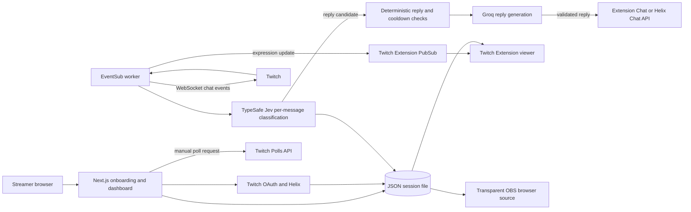

# MurMur

**A mascot that grows with your chat.**

MurMur gives Twitch streams a customizable animated mascot that reacts to individual chat messages. A TypeSafe Jev model classifies a message's tone, the mascot changes expression, and an optional Groq reply can be sent back to chat. Streamers can show the mascot through MurMur's Twitch Video - Fullscreen Extension or as a transparent OBS browser source.

“Grows with your chat” describes the live interaction: the current implementation does not learn a persistent community profile or calculate an aggregate community mood.

## Contents

- [What works today](#what-works-today)
- [How it works](#how-it-works)
- [Architecture](#architecture)
- [Technology](#technology)
- [Twitch integration](#twitch-integration)
- [AI behavior](#ai-behavior)
- [Privacy and security](#privacy-and-security)
- [Run locally](#run-locally)
- [Environment variables](#environment-variables)
- [Twitch Extension setup](#twitch-extension-setup)
- [OBS setup](#obs-setup)
- [Project layout](#project-layout)
- [Limitations and next steps](#limitations-and-next-steps)

## What works today

- Create and name a mascot; customize its shape, color, expression, and animation. The appearance editor offers eight shapes, sixteen expressions, and fourteen selectable motion states.
- Connect the broadcaster's Twitch account with OAuth.
- Receive channel chat messages through Twitch EventSub WebSocket and classify eligible messages one at a time with TypeSafe Jev.
- Update the mascot expression in the dashboard, OBS overlay, and Twitch Extension viewers through Twitch Extension PubSub.
- Optionally generate and send short chat replies with Groq after Jev recommends replying and an application cooldown allows it.
- Create a Twitch poll manually from the dashboard. Poll creation uses Twitch's Polls API and requires an Affiliate or Partner channel.
- Use the mascot as a transparent OBS browser source without installing OBS when using the Twitch Extension.

## How it works

1. The streamer chooses a name, shape, color, expression, and motion in onboarding.
2. The streamer enters a Twitch channel name and connects that same broadcaster account through Twitch OAuth.
3. When AI chat reactions are enabled, the separate EventSub worker subscribes to `channel.chat.message` and receives messages for the connected broadcaster.
4. MurMur sends each eligible message's text to TypeSafe's `jev-latest` model. Jev selects one of the supported expressions and estimates whether a brief reply would add value.
5. MurMur saves the new expression and broadcasts it to Extension viewers. The OBS overlay polls the MurMur session endpoint and displays the current expression.
6. If Jev recommends a reply, the reply cooldown permits it, and the required providers are configured, Groq generates a short response. MurMur validates the JSON response and sends it to Twitch chat. This is automatic once the streamer enables AI chat replies; there is no approval inbox.
7. Separately, the streamer can write and start a poll from the dashboard. The poll is created directly on Twitch; Twitch handles voting.

Messages are handled individually, with a 1.5-second per-channel reaction cooldown and duplicate-message suppression in process memory. There is no aggregate chat sentiment or “Crowd Pulse” calculation in this version.

## Architecture



The Next.js app serves the landing page, onboarding, dashboard, transparent overlay, and API routes. The EventSub worker runs as a separate process alongside the web server in development and production. Both processes use the same JSON file store, so a deployment needs persistent shared storage accessible to both.

## Technology

| Technology | Use |
| --- | --- |
| Next.js 16 App Router, React 19, TypeScript | Web UI, server routes, and Twitch Extension backend endpoints |
| TypeSafe AI SDK | Calls TypeSafe Jev (`jev-latest`) to classify chat tone and reply suitability |
| Groq Chat Completions API | Generates optional short chat replies; default model is `openai/gpt-oss-20b` |
| Twitch OAuth and Helix APIs | Broadcaster authorization, account lookup, poll creation, and the chat fallback |
| Twitch EventSub WebSocket | Delivers channel chat messages to the worker |
| Twitch Extension Chat and PubSub | Sends extension chat replies and broadcasts mascot expression changes |
| Zod | Validates API inputs, provider output, stored session data, and extension claims |
| esbuild | Bundles the browser viewer for the Twitch Extension |

## Twitch integration

MurMur uses Twitch's OAuth authorization-code flow. The callback exchanges the code for tokens, checks the granted scopes, verifies that the signed-in account matches the entered broadcaster channel, and encrypts the resulting token session before storing it.

The app requests these OAuth scopes:

| Scope | Purpose |
| --- | --- |
| `user:read:chat` | Read chat through the `channel.chat.message` EventSub subscription |
| `user:write:chat` | Permit the Helix chat-message fallback |
| `channel:manage:polls` | Create broadcaster polls |

Implemented Twitch endpoints and transports:

- `GET /helix/users` verifies the OAuth account during setup.
- `POST /helix/eventsub/subscriptions` creates a WebSocket subscription for `channel.chat.message`, version `1`.
- `POST /helix/extensions/chat` sends replies as the Extension when its Chat capability is configured. The server includes `POST /helix/chat/messages` as a fallback path.
- `POST /helix/extensions/pubsub` broadcasts expression changes to Extension viewers.
- `POST /helix/polls` creates a poll from the dashboard.
- Twitch OAuth authorize, token, refresh, and revoke endpoints manage broadcaster authorization.

The Twitch Extension backend verifies the Extension JWT signature, expiration, audience/client ID when supplied, and channel claims before returning channel state. Extension chat requires Chat Capabilities to be enabled for the Extension. Polls are a separate dashboard action and are available only to Twitch Affiliates and Partners; MurMur cannot grant channel eligibility.

If Twitch is not connected, the mascot can still be customized and previewed locally. Chat reactions and Twitch actions need their respective Twitch configuration, authorization, and provider setup.

## AI behavior

- **TypeSafe Jev (`jev-latest`)** classifies one chat message into one of MurMur's sixteen expressions and returns a `shouldReply` score. The app replies only when the score is at least `0.82`.
- **Groq** is called only when a reply is recommended and the per-channel reply cooldown has elapsed. The default model is configurable with `GROQ_MODEL` and defaults to `openai/gpt-oss-20b`.
- Application code applies message length checks, duplicate suppression, a 1.5-second reaction cooldown, and a 12-second reply cooldown per channel. Reply output is schema-validated and limited to 280 characters before sending.
- The reply prompt treats chat text as untrusted and requests a short, safe response. This prompt and schema are safeguards, not a guarantee that model output is always safe. The app does not provide human review before an enabled chatbot publishes a reply.
- When TypeSafe is unavailable, chat classification fails and is logged by the worker. When Groq is not configured, the expression can still change but no generated reply is sent. Provider and Twitch failures can prevent a reaction or reply; the worker logs the error and continues processing later events.

Poll wording and options are entered by the streamer and sent directly to Twitch. AI does not create or publish polls.

## Privacy and security

- The worker sends message text to TypeSafe for classification. If a reply is generated, that message text is also sent to Groq. The code does not send the chatter's username or user ID to either AI provider.
- MurMur does not persist raw chat message text in its session store. It keeps message IDs for duplicate suppression and per-channel cooldown state in process memory; those maps are bounded or expire as the process runs.
- The JSON session file contains mascot settings, the overlay key, channel settings, and an encrypted Twitch token record. Twitch access and refresh tokens are encrypted with AES-256-GCM using a key derived from `TWITCH_SESSION_SECRET`. The local store writes the file with owner-only permissions where the operating system supports them.
- The browser also stores the mascot session and overlay key in `localStorage`. The overlay key grants access to that session, and the OBS URL includes it as a query parameter. Treat the URL as a credential and do not post it publicly.
- Server API keys and the Extension shared secret are read from server environment variables. The Extension build script embeds only the backend and dashboard URLs in its generated browser config; it does not put provider keys or Twitch OAuth secrets in the Extension package.
- `.env.local`, `.data/`, dependency directories, and generated Extension assets are Git-ignored. Keep credentials in `.env.local` or the deployment's secret manager, never in committed source or screenshots.

## Run locally

### Prerequisites

- Node.js 20.9 or newer and npm.
- Twitch Developer Console credentials for Twitch-connected features.
- A TypeSafe API key for chat expression reactions and a Groq API key for generated replies.
- A Twitch Extension ID, shared secret, version, and numeric owner ID to use the Extension integration.

### Install and start

```powershell
git clone <repository-url>
cd Murmur
npm ci
Copy-Item .env.example .env.local
npm run setup:env
npm run dev
```

`npm run setup:env` asks for Twitch, TypeSafe, and Groq settings, hides secret prompts, and generates `TWITCH_SESSION_SECRET`. It writes `.env.local`, which is ignored by Git. To preview the mascot without connecting services, install dependencies and run `npm run dev`; provider credentials are needed only for the corresponding integrations.

The development command starts Next.js and the EventSub worker together. Open `http://localhost:3000`, create the mascot, and use the dashboard. The dev command builds local Extension assets before starting the app. The local Extension asset base URL is `http://localhost:3000/twitch-extension/`.

### Build and available scripts

```powershell
npm run lint
npm run build
npm start
npm run extension:build
npm run extension:package
```

There is no test script in `package.json` at this time. `npm run build` also builds the Extension assets. `npm start` runs the production web server and EventSub worker together.

For a long-running deployment, build with `npm run build`, then run `npm start`. Mount persistent storage for `.data/sessions.json` and make it available to both processes. A host that cannot run a persistent WebSocket worker needs a separate worker process and shared persistent storage; the current JSON store is not a multi-instance database.

## Environment variables

Use `.env.example` as the variable-name reference. The following values are read by the application and build scripts:

| Variable | Purpose | Required when | Example |
| --- | --- | --- | --- |
| `TWITCH_CLIENT_ID` | Twitch OAuth application client ID | Connecting a Twitch broadcaster | `<from Twitch Developer Console>` |
| `TWITCH_CLIENT_SECRET` | Twitch OAuth application secret | Connecting a Twitch broadcaster | `<secret; keep local>` |
| `TWITCH_REDIRECT_URI` | OAuth callback URL; local default is `http://localhost:3000/api/twitch/callback` | Connecting a Twitch broadcaster | `http://localhost:3000/api/twitch/callback` |
| `TWITCH_SESSION_SECRET` | Encryption secret for saved Twitch OAuth tokens; at least 32 characters | Connecting a Twitch broadcaster | `<generate locally; do not commit>` |
| `TYPESAFE_API_KEY` | TypeSafe API credential for Jev classification | Chat reactions | `<from TypeSafe>` |
| `GROQ_API_KEY` | Groq API credential for reply generation | AI chat replies | `<from Groq>` |
| `GROQ_MODEL` | Groq model name | Optional; default `openai/gpt-oss-20b` | `openai/gpt-oss-20b` |
| `TWITCH_EXTENSION_ID` | Twitch Extension client ID | Extension state, PubSub, and Extension Chat | `<from Twitch Extension Console>` |
| `TWITCH_EXTENSION_SECRET` | Base64 shared secret from Extension settings (decoded value must be at least 32 bytes) | Extension backend integration | `<secret; keep local>` |
| `TWITCH_EXTENSION_VERSION` | Extension version passed to Extension Chat | Extension backend integration | `0.1.0` |
| `TWITCH_EXTENSION_OWNER_ID` | Numeric Twitch ID of the Extension owner | Extension backend integration | `<numeric Twitch user ID>` |
| `TWITCH_EXTENSION_ALLOWED_ORIGINS` | Optional comma-separated extra origins allowed by Extension API CORS | Only for additional Extension origins | `<optional origins>` |
| `MURMUR_EXTENSION_EBS_URL` | Backend base URL written into generated Extension `config.js`; blank uses the Extension page's origin | Hosted Extension package | `https://murmur.example.com` |
| `MURMUR_DASHBOARD_URL` | Dashboard link written into generated Extension config; defaults to the EBS URL | Hosted Extension package | `https://murmur.example.com/dashboard` |
| `BLOUB_DATA_FILE` | Optional path for the JSON session store | Optional; defaults to `.data/sessions.json` | `.data/sessions.json` |

The Twitch OAuth app and Twitch Extension have separate IDs and secrets. Do not reuse one in place of the other. For manual setup, use a cryptographically random `TWITCH_SESSION_SECRET` with at least 32 characters. The setup script generates one automatically.

## Twitch Extension setup

1. Create a Twitch Extension and select **Video - Fullscreen**. Enable its Chat capability if replies should be sent through Extension Chat.
2. In the Extension version's Asset Hosting settings, use `http://localhost:3000/twitch-extension/` as the local Testing Base URI. Set the viewer path to `index.html` and the config path to `config.html`.
3. Set the Extension's allowed backend URL/origin as required by the Twitch console. For local testing, the local asset and backend origin is `http://localhost:3000`.
4. Add the Extension ID, Base64 shared secret, version, and numeric owner ID to `.env.local`. The setup script can prompt for these values.
5. Run `npm run dev`, enable the Extension for local testing, then use Twitch's local test flow. The app's dashboard can also open the Extension setup page.

For a Hosted Test package, first deploy MurMur to a public HTTPS URL, then build with that backend URL in the environment. In PowerShell:

```powershell
$env:MURMUR_EXTENSION_EBS_URL = "https://murmur.example.com"
$env:MURMUR_DASHBOARD_URL = "https://murmur.example.com/dashboard"
npm run extension:package
```

The ZIP is created at `artifacts/murmur-twitch-extension.zip`. Upload it in the Twitch Extension Manager, set the version to Hosted Test, allow the intended test accounts, install the Extension on the channel, and activate the video overlay. The ZIP is generated output and is excluded from Git.

## OBS setup

OBS is optional when using the Twitch Extension. To use a browser source:

1. Open **Onboarding → Optional · OBS** and copy the generated URL: `http://localhost:3000/overlay?key=<your-overlay-key>` during local development.
2. In OBS, add a **Browser Source**, paste the URL, and set its width and height to your scene canvas (commonly 1920 × 1080).
3. Keep the source background transparent. The overlay is positioned at the lower-right corner and renders the mascot at up to 260 px.

For a deployed server, use its HTTPS host in place of `localhost:3000`. The URL contains the session's secret overlay key; keep it private. MurMur implements a generic browser overlay and does not include a dedicated Streamlabs integration or a Streamlabs-specific setup/verification flow.

## Project layout

```text
app/                         Next.js pages and API routes
  api/                       Twitch, overlay, and Extension backend routes
  dashboard/                 Streamer controls and Twitch poll form
  onboarding/                Mascot setup and optional OBS instructions
  overlay/                   Transparent browser-source overlay
components/                  Dashboard, onboarding, mascot, and Twitch UI
lib/                         Session store, Twitch APIs, chat and mascot logic
lib/bloub/                   Adapted mascot geometry, expressions, and animation engine
scripts/                     Environment setup, Extension packaging, EventSub worker
twitch-extension/            Twitch viewer, config page, and styles
public/                       Logo and public assets
.env.example                  Safe environment-variable template
```

## Limitations and next steps

### Implemented

- Custom mascot name, shape, color, expression, and motion.
- Individual-message Jev expression classification, optional Groq replies, Twitch Extension viewer and PubSub updates, and transparent OBS overlay.
- Streamer-started Twitch polls through the Helix Polls API, subject to Twitch account eligibility.

### Not implemented in this repository

- Aggregate community mood, Crowd Pulse, long-term sentiment, or adaptive community profiling.
- Personality or boundary editor, custom community vocabulary/glossary, or per-viewer contribution tracking.
- Approval Inbox, human approval workflow for chatbot messages, or AI-authored polls. Enabled AI replies are published automatically; polls are manually written and started by the streamer.
- In-app voting UI, poll result tracking, moderator control panel, or moderator-specific workflow.
- Dedicated Streamlabs configuration or verified Streamlabs compatibility.

The JSON file store is intended for a single app/worker deployment with shared persistent storage. Replace it with a shared database before running multiple app instances. The project has no committed test suite or documented roadmap yet.
